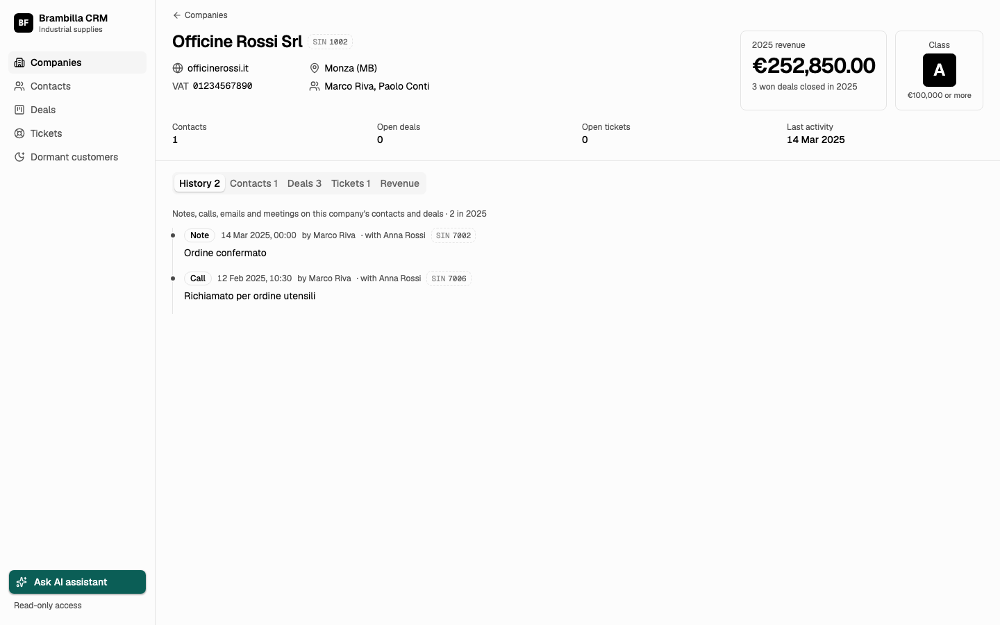
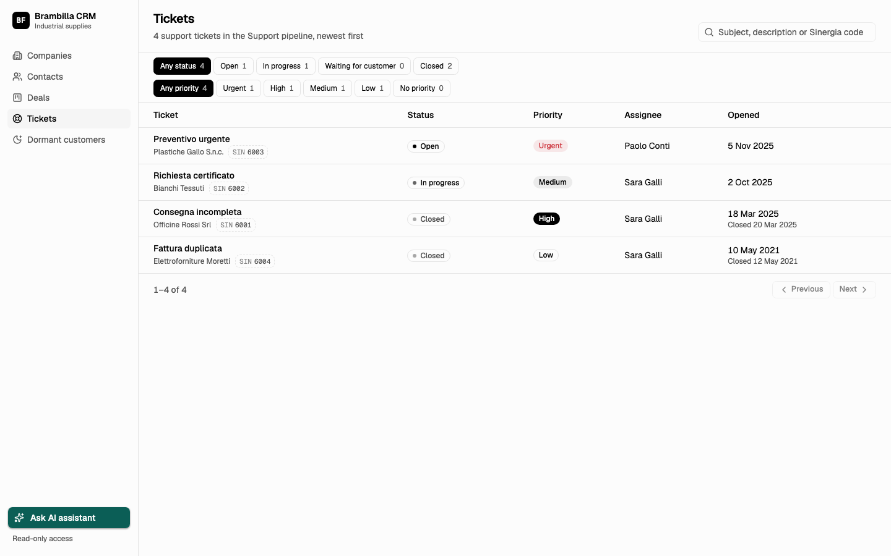
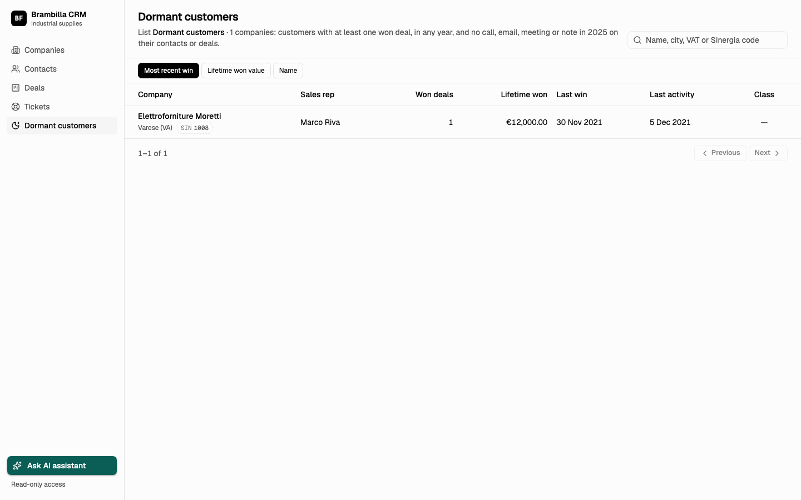

# Brambilla CRM



**A new CRM, built in five hours from an empty repo, that swallows a 15-year legacy export in 22 seconds.**

Built solo by Leonardo Pierini at the **Italian Hackathon League final**, hosted by Yellow Tech at OGR Tech Torino, 9 October 2026. Result: **top 10**.

The client is fictional: Brambilla Forniture S.p.A., an industrial-supplies distributor that is retiring its on-premise Sinergia 4 CRM. The brief: build its replacement during the race. An API compatible with the HubSpot CRM v3 API, an interface people can use the next day, and one AI assistant that works inside the CRM. A hidden test suite then hits the deploy through its API.

```text
POST /__migrate downloads a 20 MB zip of nine Windows-1252 CSVs.
676,673 rows come in. Deleted rows go. Duplicates merge. Broken references go empty.
17,386 companies, 63,678 contacts, 33,577 deals, 349,287 activities come out.
Every imported company, contact, deal, ticket and activity keeps its Sinergia ID.
The assistant reads and writes through the same code path as the API.
```

---

## Why this exists

Legacy CRM exports are never clean. This one had every problem at once, and the organizers' hidden export had the same shape with different data. Nothing could be hard-coded.

| Pressure in the data | What the CRM does about it |
| --- | --- |
| `cancellato` written as `S`, `s`, `SI`, `Sì`, `1` | One yes-like rule, applied before any dedupe, so deleted rows never merge into live ones |
| 19,698 company rows, many the same firm | Union-find on normalized domain **or** VAT number. The newest row keeps its legacy ID; each field takes its newest non-empty value |
| VAT numbers buried in free-text notes (`P. IVA: IT 01234567890 - pagamento 30gg`) | Regex extraction into a unique `partita_iva`. A second create with the same VAT gets `409` |
| Amounts like `€206,5k`, `1,4 Mln`, `51.315,91 mensili`, `(1.234,50)` | One parser for Italian and English formats, multipliers, and monthly renewals (x12) |
| Credit notes stored as negative "won" deals | Kept as won deals, so 2025 revenue nets them out |
| `Mosè` (UTF-8 bytes read as Windows-1252) in about 4,700 fields | Re-encode and decode only when the repair is clean |
| Deals owned by reps who left years ago | Same person's active account if there is one, else walk up `responsabile` to the nearest active manager |
| Email and phone in each other's columns | Swap detected per row and reversed |
| 5-minute hard limit on the migration request | Build the model in memory, then `COPY` into Postgres and rebuild indexes after. 22 s on Railway |

Every case, with the column, a synthetic example row, the real count, the rule, and how it was verified, is in [docs/choices.md](docs/choices.md). A condensed version was submitted as the choice sheet.

---

## What you get

1. **Migration** (`crm/src/migrate/`). `POST /__migrate {"export_url": "..."}` downloads the archive, finds the nine files by name or by header, repairs encoding, builds companies, contacts, deals, line items, products, tickets and activities, computes 2025 revenue and customer class (R8), builds the "Clienti dormienti" list (R9), and loads it all in one transaction.
2. **CRM API** (`crm/src/api/`). Objects (CRUD, batch, upsert, search), associations v4 with labels, properties and groups, pipelines and stages, lists (manual and dynamic), async CSV exports, error shapes and rate-limit headers. Served under the `2026-09` date-versioned paths the brief asked for, with `/crm/v3` and `/crm/v4` aliases.
3. **Business rules on every write.** R7: duplicate VAT returns `409`. R10: a deal moved to won opens exactly one support ticket for its rep. R11: a lost deal creates one call-back task due in 180 days. R12: a new contact without a company is linked by email domain, never overwriting an existing link.
4. **AI assistant** (`crm/src/agent/`). `POST /__agente` takes the whole conversation (stateless) plus optional semicolon CSV attachments. A tool loop on OpenRouter with nine tools: search, get, create, update, associate, archive, company revenue, users, date math. The tools call the same service layer as the API, so R7, R10, R11 and R12 fire exactly as they do over HTTP. Guards live in code, not only in the prompt. It replies in the user's language and has a hard 50 s deadline per turn.
5. **Web interface** (`crm/web/`, Vite + React + shadcn/ui, served by Fastify). The four pages the brief says the jury reviews: company page, deals board (drag a card to change stage), dormant customers, tickets. Plus companies and contacts lists and an assistant panel on every page. Browsing is public; writes ask for the token.

```text
crm/
  src/server.ts        Fastify: /health, auth hook, /__reset, /__migrate, /__agente, UI shell
  src/store.ts         Postgres schema, reset to a fresh account, transactions
  src/migrate/         export.ts (zip, encoding) -> model.ts (R1-R6) -> rules.ts (R8, R9) -> load.ts (COPY)
  src/api/             HubSpot-style CRM API + /ui-api reads for the web app
  src/agent/           prompt, OpenRouter client, tools, language detection
  web/                 React app, built into crm/public
  test/                unit tests (normalizers, users, R8) and assistant tests with a scripted model
  scripts/             check.ts (end-to-end API check), durability.ts, agent-scenarios.ts, sample-export.ts
  sample/              a tiny synthetic Sinergia export, invented data
```

| Screen | |
| --- | --- |
|  |  |

Screenshots are from the synthetic sample export, not the real data.

---

## Quick start

Needs Node 24+ and PostgreSQL. No API key needed unless you want the assistant to answer.

```bash
# Postgres (any local instance works; this is one way)
docker run -d --name crm-pg -e POSTGRES_PASSWORD=postgres -e POSTGRES_DB=crm -p 5432:5432 postgres:17

cd crm
cp .env.example .env            # edit CRM_TOKEN; OPENROUTER_API_KEY is optional
npm ci
npm ci --prefix web && npm run build --prefix web   # builds the UI into crm/public
npm run build
set -a; source .env; set +a
npm start                       # http://localhost:3000
```

The organizers' export is not in this repo. Migrate the synthetic sample instead:

```bash
# second terminal, from crm/
set -a; source .env; set +a
npx tsx scripts/sample-export.ts                     # writes sample/sample-export.zip (Windows-1252, like the original)
python3 -m http.server 8787 --directory sample &

curl -X POST http://localhost:3000/__migrate \
  -H "Authorization: Bearer $CRM_TOKEN" -H "content-type: application/json" \
  -d '{"export_url":"http://localhost:8787/sample-export.zip"}'
```

Then open http://localhost:3000/companies. The sample has 8 company rows that merge into 5 (one by domain, one by VAT, one deleted), a mojibake name, a credit note, a monthly renewal, a USD deal, an email/phone swap, inactive owners, and one dormant customer.

Tests and checks:

```bash
npx tsx --test test/migrate.test.ts                              # pure rules, no database
npx tsx --test test/agent.test.ts                                # resets the DATABASE_URL database; scripted model, no API calls
CRM_URL=http://localhost:3000 CRM_TOKEN=$CRM_TOKEN \
  EXPORT_URL=http://localhost:8787/sample-export.zip npx tsx scripts/check.ts   # resets and migrates, then 34 API checks
```

---

## Status

What happened on the day:

- The deploy passed the platform's final form check at 15:11: 6/6, migration 21.68 s, example tests 10/10, assistant OK.
- Migration ran in 22-27 s on Railway (14.6 s locally) against a 300 s limit.
- The assistant cost about $0.014 of its $10 budget during development: scripted-model tests first, a few real rounds after.

What was checked for this repo (8 November 2026, fresh install, local Postgres 17, no API keys):

- `test/migrate.test.ts` 10/10, `test/agent.test.ts` 12/12.
- `scripts/check.ts` on the synthetic sample: 34/34 PASS (CRUD on 11 object types, R7, R10, R11, R12, lists, exports, errors).
- UI builds and serves. Without an OpenRouter key, `/__agente` answers with a polite "not available" in Italian and changes nothing.

Limits:

- The Imports API was not built.
- The real export and the hidden test suite belong to the organizers, so the full-scale numbers above cannot be reproduced from this repo. The sample shows the behavior, not the volume.
- The assistant is wired to `openai/gpt-6-luna` on OpenRouter, the only model the rules allowed.
- Built in one day. Code comments and docs mix English with Italian field names (`ragione_sociale`, `fatturato_2025`), because the client's data is Italian.

---

## Docs

- [docs/choices.md](docs/choices.md): every data case found and the rule chosen for it.
- [docs/prd.md](docs/prd.md): the plan written at the start of the day, with time-boxed milestones.
- [docs/design.md](docs/design.md): UI direction.
- [docs/sinergia-export-profile.md](docs/sinergia-export-profile.md): the export's files, columns and observed variations.

## Credits

Solo entry (the final was an individual competition) by Leonardo Pierini.

The Italian Hackathon League organizers and Yellow Tech provided the challenge brief, the client requests, the Sinergia export, the assistant examples, and the hidden test suite. None of that is redistributed here. "Brambilla Forniture" and its data are fictional, created for the challenge. HubSpot is named only to describe API compatibility; the app does not use its name or logo.

## License

MIT. See [LICENSE](LICENSE).
